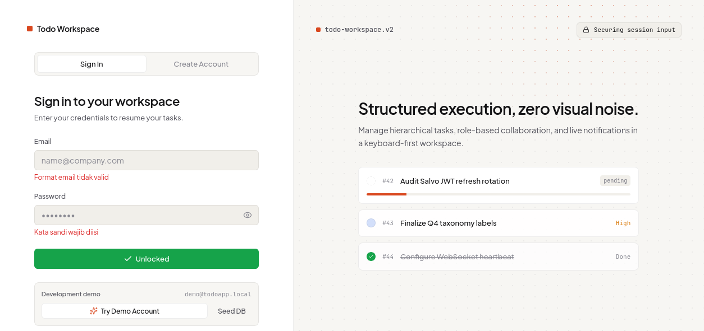
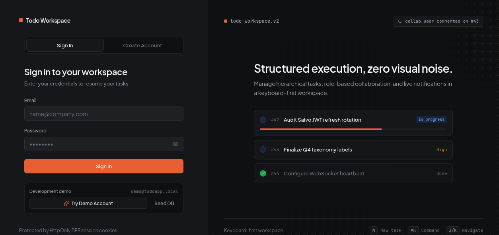
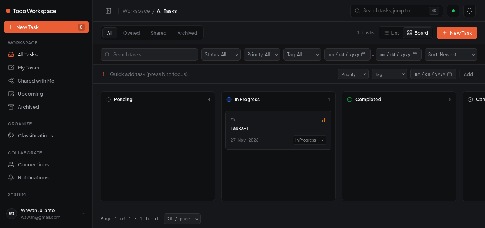
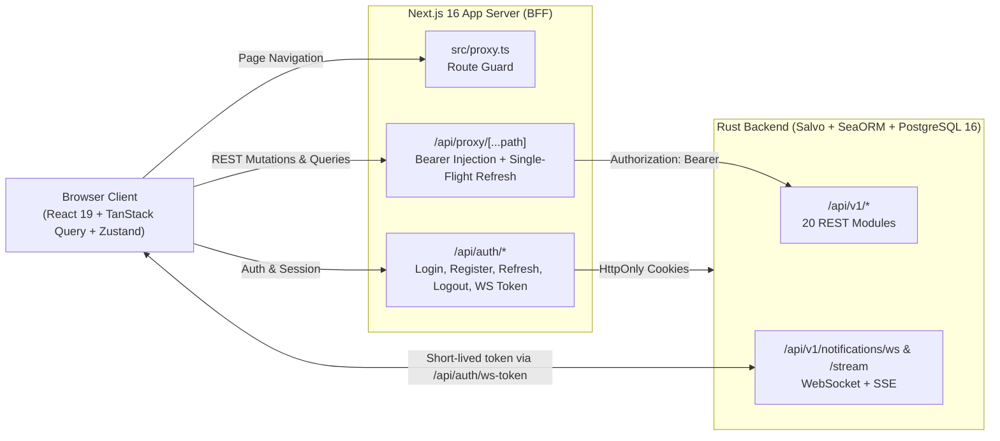

# Todo App v2 — Frontend

A keyboard-first, real-time task execution workspace built with **Next.js 16 (App Router + Turbopack)**, **React 19**, **Tailwind CSS v4**, and a **Backend-for-Frontend (BFF) cookie auth proxy**, paired with a **Rust** REST & dual-transport real-time backend.

[](https://nextjs.org/)
[](https://react.dev/)
[](https://www.typescriptlang.org/)
[](https://tailwindcss.com/)
[](https://motion.dev/)
[](https://github.com/QuantaVoxel/rust-todo-app-backend)
[](./LICENSE)

[Features](#key-features) · [Architecture](#architecture--data-flow) · [Backend Repo](https://github.com/QuantaVoxel/rust-todo-app-backend) · [Quick Start](#getting-started) · [Keyboard Shortcuts](#keyboard-shortcuts)

---

## Preview

<!-- Replace the placeholder image files under ./docs/screenshots/ before publishing -->

| Workspace — Light Mode (Warm Paper) | Workspace — Dark Mode (Obsidian Ink) |
| :---: | :---: |
|  |  |

| Contextual Task Inspector | Kinetic Split-Screen Auth |
| :---: | :---: |
|  |  |

---

## Full-Stack Ecosystem

> **Backend Repository:** **[QuantaVoxel/rust-todo-app-backend](https://github.com/QuantaVoxel/rust-todo-app-backend)**
>
> This frontend is engineered to integrate 1:1 with the Rust backend powered by **Salvo**, **SeaORM**, and **PostgreSQL 16**—covering **20 REST API modules**, **JWT refresh token rotation**, and **dual-transport real-time notifications (WebSocket + SSE)**.

---

## Key Features

### Task Workspace & Execution
- **List & Board Views**: Switch between structured list rows and status-grouped board columns with multi-criteria filtering (status, priority, search, archived toggle) and server-backed pagination.
- **Contextual Task Inspector**: Dedicated 4-tab inspector (`Work`, `Discuss`, `Schedule & Context`, `History`) with inline title & description editing, properties table, and live progress slider.
- **Subtasks & Notes**: Inline subtask checklist with completion tracking and rich task notes with full version history.
- **Attachments, Scheduling & Context**: Multipart file uploads and URL attachments, reminders, recurrence rules, geolocation metadata, external app integrations, task voting, and a read-only per-task audit timeline.

### Real-Time Notifications
- **Dual-Transport Engine**: Connects via authenticated WebSocket (`/api/v1/notifications/ws`) with automatic fallback to Server-Sent Events (`/api/v1/notifications/stream`) if WebSocket upgrade fails.
- **Live Inbox & Status Pill**: Real-time connection indicator (`Live · WebSocket` / `Live · SSE` / reconnecting state), unread badge synchronization, type filtering (`reminder`, `comment`, `share`, `system`), and interactive single or bulk mark-as-read.

### Classifications & Collaboration
- **Tags, Categories & Labels**: Dedicated `/classifications` workspace with instant client-side filtering, sorting, inline creation, and confirmation-guarded `?force=true` deletion when items are linked to tasks.
- **Granular Task Sharing & Connections**: Share tasks with collaborator permissions (`view`, `comment`, `edit`, `owner`) and manage user relationships (`accepted`, `pending`, `blocked`) in `/connections`.

### Audit Trail & Settings
- **Activity Logs (`/activity-logs`)**: Filterable workspace audit trail by `entity_type`, `entity_id`, `action`, and UTC date range, with client-side CSV/JSON export.
- **Structured Settings (`/settings`)**: 2-column navigation across **Profile** (live avatar preview), **Account**, **Preferences** (theme sync + custom key-value settings), **Security** (change password with strength meter + sign out), and **Danger Zone** (type-to-confirm account deletion).

### Crafted UX & Security
- **BFF Cookie Auth Proxy**: Authentication routes (`/api/auth/*`) store tokens in `HttpOnly`, `SameSite=Lax` cookies; browser requests route through `/api/proxy/[...path]` with single-flight silent refresh rotation so refresh tokens are never exposed to `localStorage`.
- **Swiss-Utilitarian Design System**: Warm Paper light mode and Obsidian Ink dark mode with `1px` hairline borders, `tabular-nums` alignment, and Swiss Vermilion accent.
- **Keyboard-First Navigation**: Global `⌘K` command palette, `J`/`K` list navigation, quick task creation (`N` / `C`), and `⌘+Enter` submissions.

---

## Architecture & Data Flow



---

## Tech Stack

| Category | Technology | Purpose |
| :--- | :--- | :--- |
| **Framework** | Next.js `16.4.6` (App Router, Turbopack) | SSR, Cache Components, BFF Route Handlers, `src/proxy.ts` guard |
| **UI Runtime** | React `19.3.0`, TypeScript `5` | Strict type-safe component architecture |
| **Styling** | Tailwind CSS `4.3.3` | Design tokens, Warm Paper & Obsidian Ink themes |
| **Primitives & Icons** | Radix UI Primitives, Lucide React `1.80.0` | Accessible dialogs, popovers, tabs, tooltips, and icons |
| **Animation** | Motion `14.14.0` | Shared-element `layoutId` indicators and reduced-motion transitions |
| **Server State** | TanStack Query `5.108.4` | Caching, optimistic updates, pagination, and query invalidation |
| **Client UI State** | Zustand `5.1.0` | Local workspace state (`activeTaskId`, `viewMode`, `sidebarCollapsed`) |
| **Forms & Validation** | React Hook Form `7.92`, Zod `4.6.7` | Schema-validated forms and backend field error mapping |
| **Utilities** | `date-fns`, `clsx`, `tailwind-merge` | Date formatting and class composition |

---

## Getting Started

### Prerequisites

- **Node.js** `>= 20.x` and **npm**
- A running instance of **[QuantaVoxel/rust-todo-app-backend](https://github.com/QuantaVoxel/rust-todo-app-backend)** (default `http://localhost:8080`)

Start the Rust backend + PostgreSQL stack first:

```bash
git clone https://github.com/QuantaVoxel/rust-todo-app-backend.git
cd rust-todo-app-backend
docker compose up -d --build
```

### Frontend Setup

1. Clone the repository and install dependencies:

```bash
git clone https://github.com/QuantaVoxel/todo-app-frontend.git
cd todo-app-frontend
npm install
```

2. Create `.env.local` from `.env.example`:

```bash
cp .env.example .env.local
```

| Variable | Default | Scope | Description |
| :--- | :--- | :--- | :--- |
| `RUST_API_BASE_URL` | `http://localhost:8080` | Server only | Internal base URL for Next.js BFF Route Handlers & Server Components |
| `NEXT_PUBLIC_WS_BASE_URL` | `ws://localhost:8080` | Browser | WebSocket endpoint base URL for real-time notifications |
| `NEXT_PUBLIC_ASSET_BASE_URL` | `http://localhost:8080` | Browser | Base URL for SSE notification fallback and `/uploads/*` attachments |
| `NEXT_PUBLIC_ENABLE_DEMO_MODE` | `true` | Browser | Enables demo quick-fill and database seed actions on `/login` (`false` in production) |

3. Run the development server:

```bash
npm run dev
```

Open [http://localhost:3000](http://localhost:3000) in your browser.

4. Create an optimized production build:

```bash
npm run build
npm run start
```

---

## Demo Accounts

When the backend demo seeder is enabled (and `NEXT_PUBLIC_ENABLE_DEMO_MODE=true`), you can use the **Try Demo Account** quick-fill button directly on `/login` or sign in with:

| Role | Username | Email | Password |
| :--- | :--- | :--- | :--- |
| Primary Demo User | `demo_user` | `demo@todoapp.local` | `Password123!` |
| Collaborator User | `collab_user` | `collab@todoapp.local` | `Password123!` |

---

## Keyboard Shortcuts

| Shortcut | Context | Action |
| :--- | :--- | :--- |
| `⌘K` / `Ctrl+K` | Global | Open or close Command Palette |
| `[` or `⌘B` / `Ctrl+B` | Workspace | Toggle collapsible sidebar |
| `N` | Tasks Workspace | Focus inline quick-create title input |
| `C` | Tasks Workspace | Open Quick Create Task modal |
| `J` / `K` or `↓` / `↑` | Tasks & Notifications | Move focus down / up through items |
| `Enter` | Tasks / Notifications | Open focused task in Inspector / mark notification read |
| `E` | Notifications | Mark focused notification as read |
| `Esc` | Inspector / Drawer | Close Task Inspector or mobile navigation drawer |
| `⌘+Enter` | Task Description / Comments | Save description or submit comment |

---

## Project Structure

```text
src/
├── app/
│   ├── (auth)/                  # Public login & register routes
│   ├── (workspace)/             # Protected workspace routes (tasks, classifications, connections, notifications, activity-logs, settings)
│   └── api/
│       ├── auth/                # BFF session handlers (login, register, refresh, logout, ws-token)
│       └── proxy/[...path]/     # Authenticated REST proxy to Rust backend
├── components/
│   ├── layout/                  # WorkspaceShell, Sidebar, Header, CommandPalette
│   ├── providers/               # TanStack Query provider
│   └── ui/                      # Reusable UI primitives
├── features/                    # Domain-sliced modules (tasks, subtasks, notes, comments, attachments, scheduling, context, classifications, connections, notifications, audit, settings, auth, collaboration)
├── lib/
│   ├── api/                     # Typed fetch client, endpoint builders, snake_case DTOs
│   ├── auth/                    # HttpOnly cookie session & token refresh helpers
│   └── utils/                   # Formatting, asset URL resolver, RBAC permission helpers
├── stores/
│   └── workspace-store.ts       # Zustand local UI state
└── proxy.ts                     # Next.js 16 route guard
```

---

## Available Scripts

| Command | Description |
| :--- | :--- |
| `npm run dev` | Start Next.js 16 development server with Turbopack |
| `npm run build` | Build production bundle and prerender static routes |
| `npm run start` | Start production Next.js server |
| `npm run lint` | Run ESLint across the repository |
| `npm run typecheck` | Run TypeScript compiler type checking (`tsc --noEmit`) |

---

## Related Repositories & License

- **Backend API**: [QuantaVoxel/rust-todo-app-backend](https://github.com/QuantaVoxel/rust-todo-app-backend) — Rust (Salvo + SeaORM + PostgreSQL 16) REST & Real-Time Server.
- **License**: Released under the [MIT License](./LICENSE).
